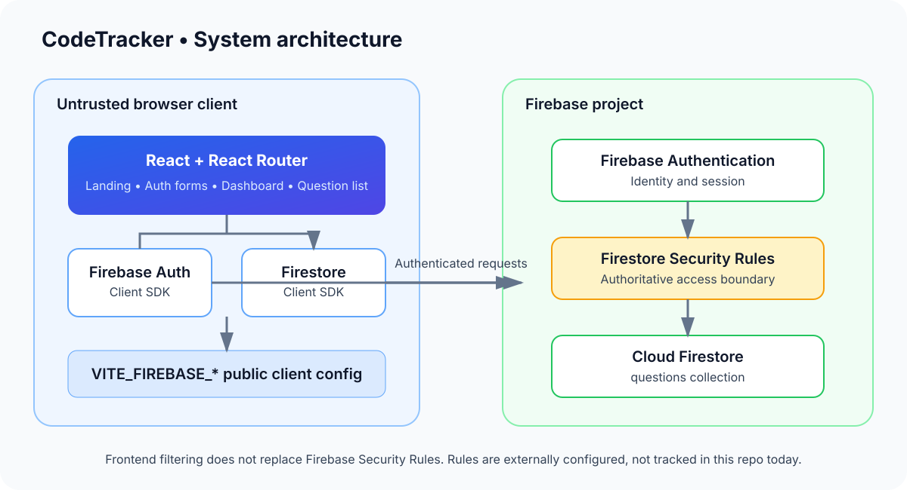

  
  <h1>CodeTracker</h1>
  
<strong>Your coding-practice history, in one place.</strong>

  
A React and Firebase frontend for reviewing existing coding-question records linked to the signed-in user.

  

    
    
    
    
    
    
  

> **Project status:** CodeTracker is an early-stage frontend. The checked-in application supports account creation, email/password sign-in, sign-out, and reading existing question documents for the authenticated user. It is not an online judge, code editor, or complete question-management system. Question creation, editing, deletion, a backend API, and Firestore Security Rules are not included in this repository.

## 🧭 Overview

CodeTracker provides a browser-based view of coding-practice question metadata already stored in Cloud Firestore. A user signs in through Firebase Authentication and opens a dashboard that queries the questions collection using the signed-in user's UID.

The dashboard currently displays these fields when present in the stored document: title, difficulty, email, link, time, and topics. The current component assumes a valid timestamp value and an array-valued topics field. Defensive data validation and a dedicated empty state are future improvements.

### ✨ Current capabilities

- 🔐 Email/password account registration and login through Firebase Authentication.
- 👤 Profile display-name update during registration.
- 🔄 Authentication-state observation through the Firebase SDK.
- 📚 Authenticated dashboard route.
- 🔎 Read-only Firestore query for question records where uid matches the signed-in user.
- 🔗 External question links opened in a new tab with safe browsing attributes.
- 🚪 Sign-out through Firebase Authentication.
- 🚀 Static single-page application hosting configuration for Firebase Hosting.

### ⚠️ Explicitly not implemented

- Question creation, editing, or deletion screens.
- Code execution, submissions, judging, or an integrated editor.
- Search, topic filters, sorting, analytics, reminders, or pagination.
- Password reset or account deletion workflow.
- A REST, GraphQL, or other backend API.
- Firestore or Storage Security Rules tracked in this repository.
- The source code of the separately distributed Microsoft Edge extension linked from the landing page.

Google sign-in handler functions exist in the authentication components but are not currently connected to visible buttons. Firebase Storage is initialized in the client configuration but is not used by the visible UI.

## 🏛️ Architecture

### 🔀 Request and data flow

~~~mermaid
flowchart TD
    A[Visitor opens CodeTracker] --> B{Account available?}
    B -->|No| C[Signup]
    B -->|Yes| D[Login]
    C --> E[Firebase Authentication]
    D --> E
    E --> F[React observes auth state]
    F --> G{Authenticated user?}
    G -->|No| H[Public routes]
    G -->|Yes| I[Dashboard]
    I --> J[Firestore query by current UID]
    J --> K[Firestore Security Rules]
    K -->|Allowed| L[Question documents]
    K -->|Denied| M[Query error]
    L --> N[Render question table]
~~~

### 🔁 Authentication sequence

~~~mermaid
sequenceDiagram
    actor User
    participant UI as React login form
    participant Auth as Firebase Authentication
    participant App as App auth observer
    User->>UI: Enter email and password
    UI->>Auth: signInWithEmailAndPassword
    Auth-->>UI: User credential or error
    Auth-->>App: Auth state change
    App-->>User: Render route tree for current session
~~~

### 🧱 System boundaries

| Layer | Technology | Responsibility |
| --- | --- | --- |
| Browser UI | React 18 | Landing, authentication forms, dashboard, question table |
| Client routing | React Router 6 | Browser routes and SPA navigation |
| Build tooling | Vite 5 | Development server and static production bundle |
| Styling | Tailwind CSS 3 | Utility-based UI styling |
| Identity | Firebase Authentication | Email/password user identity and session |
| Data | Cloud Firestore | Existing question-document reads |
| Hosting | Firebase Hosting | Static build delivery and SPA rewrite |
| Automation | GitHub Actions | Lint/build, docs validation, security and deployment workflows |

**Security boundary:** Filtering a query by uid in browser code is not authorization. Firebase Security Rules must enforce authentication and record ownership on the Firebase service. No Rules file is included here, so the Firebase project owner must configure and test restrictive Rules before using real user data.

## 🧑‍💻 Technology stack

| Area | Stack |
| --- | --- |
| Language | JavaScript ES modules |
| UI | React 18.3.1, React DOM 18.3.1 |
| Routing | React Router DOM 6.24.1 |
| Build | Vite 5.3.1 |
| Styling | Tailwind CSS 3.4.4 |
| Backend services | Firebase JavaScript SDK 10.12.3 |
| Package manager | npm |
| Quality | ESLint |
| Hosting | Firebase Hosting |
| Automation | GitHub Actions, Dependabot, CodeQL, Gitleaks |

The application package and npm lockfile live inside leetcode/. Run all app package commands from that directory.

## 🗺️ Application routes

| Route | Access | Current behavior |
| --- | --- | --- |
| / | Public | Landing page and external links |
| /login | Public | Email/password sign-in |
| /signup | Public | Account creation and display-name update |
| /dashboard | Conditional | Dashboard route is included when App observes a user |

The current router does not define a dedicated not-found page or an explicit redirect for a signed-out direct visit to /dashboard. See [Navigation Structure](docs/navigation-structure.md).

## 🖼️ Visual documentation

| Asset | Purpose |
| --- | --- |
| [Project banner](docs/assets/project-banner.svg) | Repository identity |
| [Logo](docs/assets/logo.svg) | Compact CodeTracker identity |
| [Architecture overview](docs/assets/architecture-overview.svg) | Browser and Firebase trust boundaries |
| [User workflow](docs/assets/workflow-diagram.svg) | Signup, login, dashboard, and sign-out journey |
| [Data flow](docs/assets/data-flow.svg) | Firestore query and Rules boundary |
| [Deployment flow](docs/assets/deployment-flow.svg) | Build and Hosting workflow |
| [Security architecture](docs/assets/security-architecture.svg) | Public client configuration and trusted deployment secret |

Real application screenshots are intentionally not fabricated. Add genuine screenshots under docs/assets/screenshots/ after running the application with synthetic data and verifying the displayed feature.

More Mermaid, sequence, state, and ER diagrams are in [UML and Engineering Diagrams](docs/uml-diagrams.md).

## 🚀 Getting started

### Prerequisites

- Node.js 22, as selected by the repository's .nvmrc.
- npm.
- Git.
- A Firebase project with Email/Password Authentication enabled and Cloud Firestore configured.
- Firestore Security Rules that restrict every user to their authorized data.

Use a dedicated development Firebase project and synthetic test accounts.

### 1. Clone the repository

~~~sh
git clone https://github.com/Brajesh31/CodeTracker-Frontend.git
cd CodeTracker-Frontend
~~~

### 2. Configure Firebase client values

Copy the root environment template into the nested frontend directory.

**macOS / Linux**
~~~sh
cp .env.example leetcode/.env.local
~~~

**Windows PowerShell**
~~~powershell
Copy-Item .env.example leetcode/.env.local
~~~

Fill in the Firebase Web App configuration values in leetcode/.env.local. The application reads them through import.meta.env in leetcode/src/config/firebase.jsx.

> **Important:** Every VITE_ variable is public in the compiled browser bundle. These values are not secrets. Never place service-account JSON, Firebase Admin credentials, private keys, passwords, or other privileged secrets in a VITE_ variable.

### 3. Install dependencies

~~~sh
cd leetcode
npm ci
~~~

### 4. Start the development server

~~~sh
npm run dev
~~~

Open the local URL printed by Vite. Create a synthetic account, sign in, and open the dashboard. The dashboard will only show rows when authorized question documents already exist for that user's UID.

## 🧰 Available commands

Run these commands from leetcode/.

| Command | Purpose |
| --- | --- |
| npm ci | Install exact dependencies from package-lock.json |
| npm run dev | Start the Vite development server |
| npm run lint | Run ESLint |
| npm run build | Create the production bundle in leetcode/dist/ |
| npm run preview | Preview the production bundle locally |

Repository documentation and structure checks run from the repository root:

~~~sh
python scripts/validate-docs.py
python scripts/validate-links.py
python scripts/check-project-structure.py
bash scripts/security-check.sh
~~~

These repository scripts do not replace application tests or Firebase Rules tests. The package does not currently declare a dedicated unit, integration, E2E, or emulator test suite.

## 🔐 Firebase and data safety

### Firebase client configuration

The Firebase client app is initialized in leetcode/src/config/firebase.jsx. Its values come from the root .env.example template copied to leetcode/.env.local.

### Current Firestore read

The question-list component reads from the questions collection and filters by the current user's UID. The source expects:

| Field | Use |
| --- | --- |
| uid | Query condition for the current user |
| title | Question title |
| difficulty | Difficulty label |
| email | Email value shown in the table |
| link | External question URL |
| time | Value formatted as a date |
| topics | Array rendered as comma-separated text |

This is a source-derived shape, not a formally enforced database schema. The writer for these records is not included in this repository.

### Before production use

- Configure restrictive Firestore Security Rules.
- Test cross-user read/write denial using two synthetic accounts.
- Confirm which integration writes question documents.
- Validate record field types and external URLs.
- Define data retention and account deletion behavior.
- Keep deployment credentials in protected GitHub Actions secrets.

Read [Security Policy](SECURITY.md), [Database](docs/database.md), [Security Architecture](docs/security-architecture.md), and [Threat Model](docs/threat-model.md).

## 🚢 Deployment

Firebase Hosting configuration is stored at leetcode/firebase.json. It publishes dist and rewrites browser routes to index.html.

The GitHub Actions deployment workflow installs, lints, and builds from leetcode/ before calling Firebase Hosting with the nested configuration. The workflow expects the repository secret FIREBASE_SERVICE_ACCOUNT_LEETCODE_TRACKER_6F022 and project ID leetcode-tracker-6f022. Configure that secret in GitHub repository settings. Never commit the service-account file.

A manual preview workflow is available through workflow_dispatch. Production deployment is triggered by a push to main or a manual workflow dispatch.

After deployment, verify the landing, login, signup, dashboard, direct route refresh, Firebase authentication, and Firestore authorization. See [Deployment](docs/deployment.md), [CI/CD](docs/ci-cd.md), and [Rollback](docs/rollback.md).

## 🧪 Quality and automation

The repository includes GitHub Actions workflows for:

- Frontend lint and production build.
- Documentation, local-link, SVG, structure, and secret-hygiene validation.
- Dependency review on pull requests.
- CodeQL static analysis.
- Gitleaks secret scanning.
- Dependabot updates for npm dependencies in leetcode/ and GitHub Actions.
- Protected Firebase Hosting preview and production deployment.

CI runs real commands and should be treated as authoritative only after the workflow reports success. No test-coverage percentage, production uptime, or security certification is claimed.

## 📚 Documentation index

### Product and planning
- [Product overview](docs/product-overview.md)
- [Project background](docs/project-background.md)
- [Project objectives](docs/project-objectives.md)
- [Problem statement](docs/problem-statement.md)
- [Solution overview](docs/solution-overview.md)
- [Feature inventory](docs/features.md)
- [Functional requirements](docs/functional-requirements.md)
- [Non-functional requirements](docs/non-functional-requirements.md)
- [User personas](docs/user-personas.md)
- [User journeys](docs/user-journeys.md)
- [Use cases](docs/use-cases.md)
- [Scope and limitations](docs/scope-and-limitations.md)
- [Roadmap](ROADMAP.md)

### Architecture and engineering
- [Architecture](docs/architecture.md)
- [System design](docs/system-design.md)
- [Application lifecycle](docs/application-lifecycle.md)
- [Component architecture](docs/component-architecture.md)
- [Module documentation](docs/module-documentation.md)
- [Project structure](docs/project-structure.md)
- [UML and engineering diagrams](docs/uml-diagrams.md)
- [Technology stack](docs/technology-stack.md)
- [Configuration](docs/configuration.md)
- [Environment variables](docs/environment-variables.md)
- [Page documentation](docs/page-documentation.md)
- [Design system](docs/design-system.md)
- [Color system](docs/color-system.md)
- [Typography](docs/typography.md)
- [Responsive design](docs/responsive-design.md)
- [Animation guidelines](docs/animation-guidelines.md)
- [Navigation structure](docs/navigation-structure.md)

### Data and integration
- [Application API and routes](docs/api.md)
- [Database and Firebase](docs/database.md)
- [Data dictionary](docs/data-dictionary.md)
- [Data flow](docs/data-flow.md)
- [Data validation](docs/data-validation.md)
- [Integrations](docs/integrations.md)
- [External dependencies](docs/external-dependencies.md)
- [Glossary](docs/glossary.md)

### Security, privacy, and accessibility
- [Security policy](SECURITY.md)
- [Security architecture](docs/security-architecture.md)
- [Threat model](docs/threat-model.md)
- [Security best practices](docs/security-best-practices.md)
- [Security risk register](docs/security-risk-register.md)
- [Privacy](docs/privacy.md)
- [Data retention](docs/data-retention.md)
- [Accessibility](docs/accessibility.md)
- [Keyboard navigation](docs/keyboard-navigation.md)
- [Accessibility testing](docs/accessibility-testing.md)

### Quality, delivery, and operations
- [Testing strategy](docs/testing-strategy.md)
- [QA guide](docs/qa.md)
- [Test plan](docs/test-plan.md)
- [Quality gates](docs/quality-gates.md)
- [CI/CD](docs/ci-cd.md)
- [GitHub Actions](docs/github-actions.md)
- [Deployment](docs/deployment.md)
- [Release management](docs/release-management.md)
- [Versioning](docs/versioning.md)
- [Rollback](docs/rollback.md)
- [Monitoring](docs/monitoring.md)
- [Operations](docs/operations.md)
- [Incident response](docs/incident-response.md)
- [Backup and restore](docs/backup-and-restore.md)
- [Maintenance](docs/maintenance.md)
- [Known issues](docs/known-issues.md)
- [Technical debt](docs/technical-debt.md)
- [Project status](docs/project-status.md)
- [Decision log](docs/decision-log.md)
- [Troubleshooting](docs/troubleshooting.md)
- [FAQ](docs/faq.md)

### Contributor and reusable templates
- [Contributing guide](CONTRIBUTING.md)
- [Code of Conduct](CODE_OF_CONDUCT.md)
- [Support](SUPPORT.md)
- [Documentation hub](docs/README.md)
- [Engineering templates](docs/templates/README.md)
- [Authors](AUTHORS.md)
- [Changelog](CHANGELOG.md)
- [Citation metadata](CITATION.cff)

## 🤝 Contributing

Contributions are welcome. Start with [CONTRIBUTING.md](CONTRIBUTING.md), follow the [Code of Conduct](CODE_OF_CONDUCT.md), and use the issue and pull-request templates.

For UI changes, attach genuine screenshots from the running app with synthetic data. For architecture or data-contract changes, update the diagrams, test plan, security review, and relevant docs in the same change.

## 🐛 Support and security reports

- For reproducible non-sensitive bugs, use [GitHub Issues](https://github.com/Brajesh31/CodeTracker-Frontend/issues).
- For general help, read [SUPPORT.md](SUPPORT.md).
- For suspected vulnerabilities, follow [SECURITY.md](SECURITY.md). Do not publish exploit details, tokens, credentials, or private user data in a public issue.

## 📄 License and third-party material

Original CodeTracker source and documentation authored by Brajesh Kumar are licensed under the MIT License. The license text is in [LICENSE](LICENSE). The existing LICENSE filename is retained for standard GitHub license detection.

Third-party libraries, generated starter assets, external services, the separately distributed browser extension, trademarks, and other material retain their respective owners' terms. This project is not affiliated with or endorsed by LeetCode or Microsoft.

---

  Built for focused coding-practice review. Keep records accurate, access controlled, and documentation honest.

