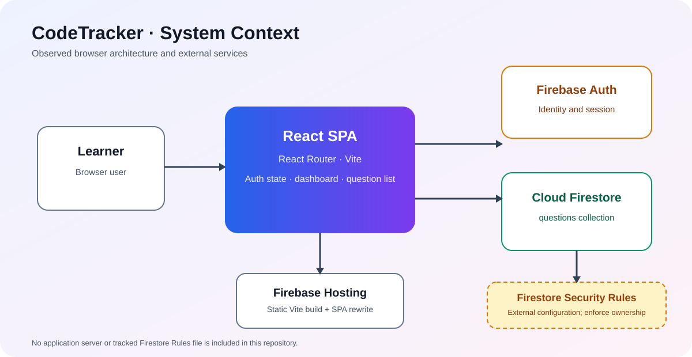

<div align="center">

# 🚀 CodeTracker

### Your personal workspace for reviewing solved coding questions

[](https://react.dev/)
[](https://vite.dev/)
[](https://firebase.google.com/)
[](LICENSE)
[](docs/README.md)

**CodeTracker** is a React single-page frontend for signing in and viewing coding-question
records associated with the current Firebase user. It uses Firebase Authentication and
reads question records from Cloud Firestore.

</div>

---

## ✨ Implemented capabilities

- 🔐 Email/password registration and login through Firebase Authentication.
- 👤 Authentication-state subscription and conditional dashboard route.
- 📚 Read-only Firestore query against the `questions` collection, filtered by the
  signed-in user's UID.
- 📊 Table view for title, difficulty, email, link, time, and topics.
- 🚪 Sign-out and a landing page linking to the separately distributed Edge extension.
- 🌐 Browser-side routing using React Router and Firebase Hosting SPA rewrites.

> **Honest project status:** This repository is a frontend, not a complete coding platform.
> The checked-in dashboard reads records but does not create, edit, or delete questions.
> The linked browser extension source is not included. No application server, REST API,
> Firestore Security Rules, automated component test suite, or data migration system is
> tracked here. Google sign-in handlers exist in source but are not exposed as UI buttons.

## 🖼️ Architecture preview



This is an architecture illustration, not a screenshot of the running application.
See the [architecture diagrams index](docs/architecture/README.md) for component,
data-flow, sequence, deployment, state, and UML views.

## 🧭 How it works

1. A visitor opens the landing page and selects login or signup.
2. Firebase Authentication creates a session or signs the user in.
3. The app observes auth state and conditionally renders the dashboard route.
4. The dashboard queries Firestore for `questions` documents whose `uid` equals the
   current Firebase UID.
5. The records are rendered as a table.

**Security boundary:** a UID filter in frontend code does not protect records. Firestore
Security Rules must independently enforce user ownership for every read and write. No
rules file is currently included in this repository.

## 🧰 Technology

| Area | Technology |
| --- | --- |
| UI | React 18 |
| Build/dev server | Vite 5 |
| Routing | React Router 6 |
| Styling | Tailwind CSS 3 |
| Authentication | Firebase Authentication |
| Data | Cloud Firestore |
| Hosting | Firebase Hosting |
| Linting | ESLint 8 |

## 📁 Repository layout

```text
.
├── .github/                  # GitHub Actions and contribution automation
├── docs/                     # Product, engineering, architecture and operations docs
├── leetcode/                 # Actual Vite application
│   ├── public/               # Browser assets
│   ├── src/
│   │   ├── Auth/             # Login and registration
│   │   ├── components/       # Landing page, dashboard, question list
│   │   └── config/           # Firebase browser initialization
│   ├── firebase.json         # Hosting points to dist/
│   ├── package.json
│   └── package-lock.json
├── scripts/                  # Repository validation utilities
├── templates/                # Reusable engineering templates
├── .env.example
├── LICENSE
├── README.md
└── SECURITY.md
```

The exact tracked tree is maintained in [docs/project-structure.md](docs/project-structure.md)
and checked by repository validation.

## ⚡ Quick start

### Prerequisites

- Git
- Node.js and npm compatible with the lockfile in `leetcode/`
- A Firebase development project with Email/Password Authentication enabled and
  Cloud Firestore configured

### 1. Clone and install

```bash
git clone https://github.com/Brajesh31/CodeTracker-Frontend.git
cd CodeTracker-Frontend/leetcode
npm ci
```

### 2. Configure Firebase

Copy the root example file into the Vite app directory:

```bash
cp ../.env.example .env.local
```

Fill in the `VITE_FIREBASE_*` values for a development Firebase Web App.
Restart Vite after editing environment values.

⚠️ **Vite exposes variables with the `VITE_` prefix in the browser bundle.**
They are public client configuration, not secrets. Never place service-account
credentials, private keys, or admin tokens in `.env.local`.

### 3. Run locally

```bash
npm run dev
```

### 4. Build and lint

```bash
npm run lint
npm run build
npm run preview
```

Run application scripts from `leetcode/`, because the package and lockfile are nested there.

## 🧪 Current verification and gaps

| Area | Current repository state |
| --- | --- |
| Build tooling | Vite build script exists; run it to verify. |
| Linting | ESLint script exists; current source may need fixes before it passes. |
| Automated UI tests | No test runner or component suite is configured. |
| Firestore rules | Not tracked; configure and test in Firebase project/emulator. |
| CRUD | Dashboard currently reads questions only. |
| Accessibility | No formal WCAG audit or screen-reader sign-off is recorded. |
| CI deployment | Existing workflows need dependency installation and the nested app working directory. |

## 🔒 Security and privacy

- Enforce authorization with restrictive Firestore Security Rules.
- Keep production data out of screenshots, issues, and test fixtures.
- Never commit `.env.local`, service account JSON, credentials, or tokens.
- Validate external links and Firestore document fields before rendering them.
- Use a development Firebase project for previews and manual testing.

Read the [Security Policy](SECURITY.md) and [security documentation](docs/security/README.md).

## 📚 Documentation

| Guide | Purpose |
| --- | --- |
| [Documentation index](docs/README.md) | All guides, diagrams, templates and operating notes |
| [Architecture](docs/architecture/README.md) | Context, components, data flow, sequence, deployment and UML |
| [Product overview](docs/product/overview.md) | Scope, users, workflows and current behavior |
| [Requirements](docs/product/requirements.md) | Functional and non-functional requirements with status |
| [Development](docs/engineering/development.md) | Tooling, source boundaries and checks |
| [Data model](docs/engineering/data-model.md) | Observed Firestore fields and data quality |
| [Security](docs/security/README.md) | Trust boundaries, threats and rules checklist |
| [Deployment](docs/operations/deployment.md) | Firebase Hosting and GitHub Actions |
| [Troubleshooting](docs/operations/troubleshooting.md) | Local, Firebase and deployment issues |
| [Accessibility](docs/quality/accessibility.md) | Risks and manual verification plan |
| [Testing strategy](docs/quality/testing.md) | Existing and recommended quality gates |
| [Repository audit](docs/repository-enhancement-audit.md) | Checklist-to-file traceability |

## 🗺️ Roadmap

Near-term priorities are to repair CI build/deploy paths, add Firestore rules and emulator
tests, validate malformed documents, add empty states and protected-route behavior, and
establish component-level tests. See [ROADMAP.md](ROADMAP.md).

## 🤝 Contributing

Read [CONTRIBUTING.md](CONTRIBUTING.md), follow its pull request checklist, and report
the verification steps you actually ran.

## 📄 License

Original CodeTracker code and documentation authored by Brajesh Kumar are licensed
under the [MIT License](LICENSE). Third-party dependencies, generated assets, external
services, browser extensions, logos and trademarks retain their respective terms.
CodeTracker is not affiliated with or endorsed by LeetCode or Microsoft.

<div align="center">Made with ❤️ by **Brajesh Kumar**</div>

Last updated: 2026-11-17 22:10 UTC
