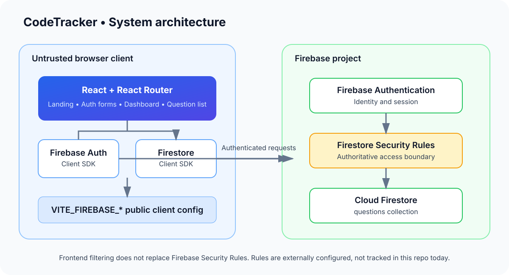

# 🏛️ Architecture

## At a glance

CodeTracker is a browser-only React single-page application. Vite serves it locally and builds static files. Firebase Authentication supplies the current user identity; the Firebase JavaScript SDK reads Cloud Firestore directly from the browser. Firebase Hosting serves the Vite build and rewrites browser paths to the SPA entry point.

~~~mermaid
flowchart LR
    Browser[Browser] --> React[React UI and Router]
    React --> AuthSDK[Firebase Authentication SDK]
    React --> FirestoreSDK[Cloud Firestore SDK]
    AuthSDK <--> Auth[Firebase Authentication]
    FirestoreSDK --> Rules[Firestore Security Rules]
    Rules --> DB[(Cloud Firestore)]
    Vite[Vite source in leetcode/] --> Build[leetcode/dist/]
    Build --> Hosting[Firebase Hosting]
~~~

Security Rules are an essential external configuration. No Firestore Rules file is tracked here. The app's client-side query filter does not enforce authorization.

## Source boundaries

- leetcode/src/main.jsx mounts React, the root App, and BrowserRouter.
- leetcode/src/App.jsx observes Firebase Authentication state, shows initial auth loading, protects /dashboard, and defines a catch-all not-found view.
- leetcode/src/Auth/ contains semantic email/password registration and login forms with inline generic error feedback. Google sign-in UI is not implemented.
- leetcode/src/components/LandingPage.jsx links to an independently published Edge extension. The extension implementation is not present here.
- leetcode/src/components/Dashboard.jsx shows the current user's display name, responsive navigation disclosure, and sign-out action.
- leetcode/src/components/AllQuestions.jsx queries Firestore collection questions, filters by uid, normalizes values for display, validates HTTP(S) links, and renders loading/empty/error/populated states.
- leetcode/src/config/firebase.jsx initializes the Firebase client app, Authentication, Firestore, and Storage. The current UI uses Authentication and Firestore; no storage feature is apparent in the current routes.
- leetcode/firebase.json configures Hosting to publish dist and rewrite requests to index.html.

## Request and data flow

1. On app mount, App subscribes to Firebase onAuthStateChanged and displays a pending status until the first callback.
2. A visitor can use the email/password forms to register or sign in.
3. When signed in, the /dashboard route is available; signed-out direct visits redirect to /login.
4. AllQuestions sends a Firestore query for documents in questions whose uid equals the current Firebase UID.
5. The component normalizes title, difficulty, email, link, time, and topics values before rendering a table.
6. Firebase Security Rules evaluate the request. They must authorize only the intended user's records, regardless of the query sent by the browser.
7. Unknown paths display a not-found view with a route back to the landing page.

There is no application server or REST/GraphQL API in the tracked app. The companion extension may be a separate producer of Firestore documents; its code and contract are not included here.

## Deployment flow

The npm package, npm lockfile, and Firebase Hosting configuration live in leetcode/. GitHub workflows set their working directory to that app folder, run npm ci, lint and build, and pass the nested configuration location to the Firebase Hosting action. The production workflow deploys from main; the preview workflow is manually dispatched so deployment credentials are not exposed to untrusted pull requests.

The workflow files are configuration, not proof of a successful deployment. Check the first actual CI and Hosting run before treating the pipeline as verified. See [Deployment](deployment.md) and [CI/CD](ci-cd.md).

## Known design limitations

- The dashboard does not create, edit, or delete question records.
- Query results are not paginated or bounded by a result limit.
- Firebase client configuration is public after bundling; Firebase Rules provide access control.
- The app routes and document schema are source-derived rather than a versioned API/data contract.
- No unit, integration, E2E, or Firebase Emulator test suite is currently declared by the frontend package.
